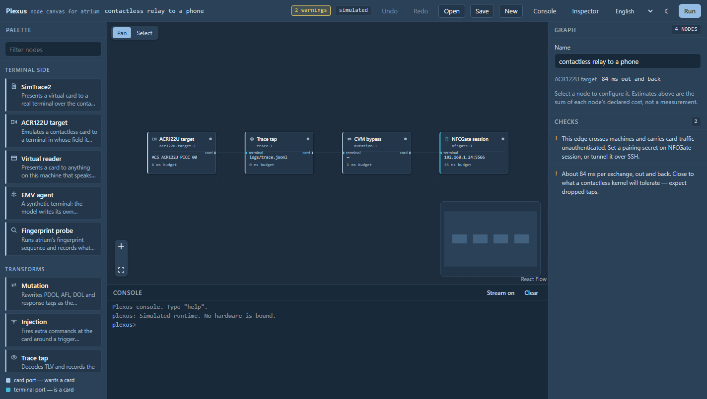
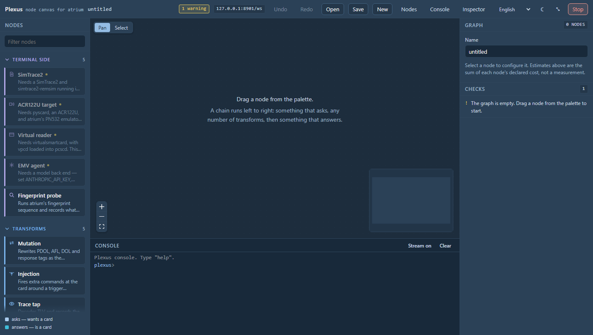
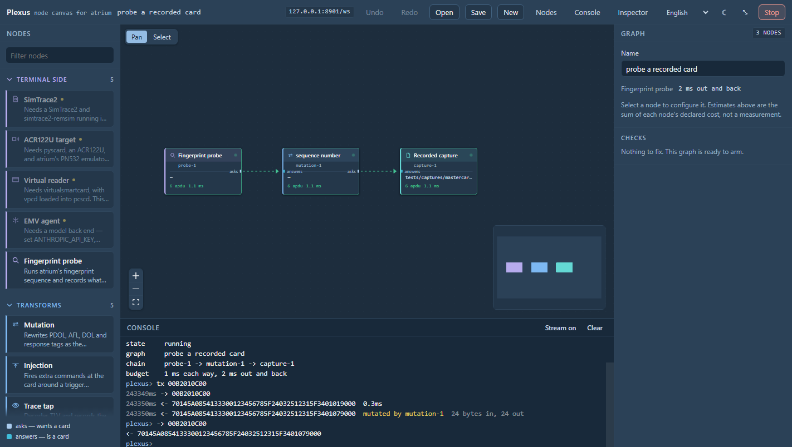
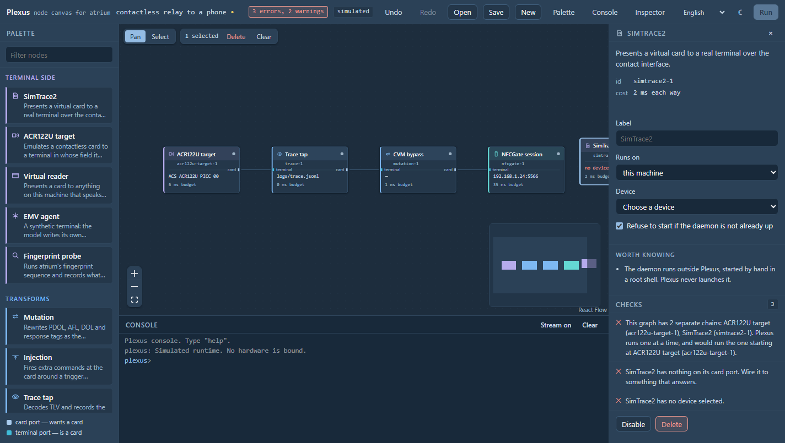
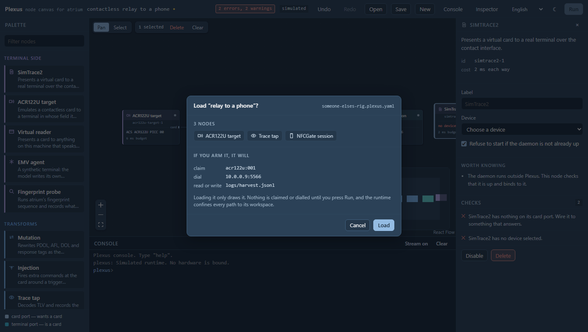
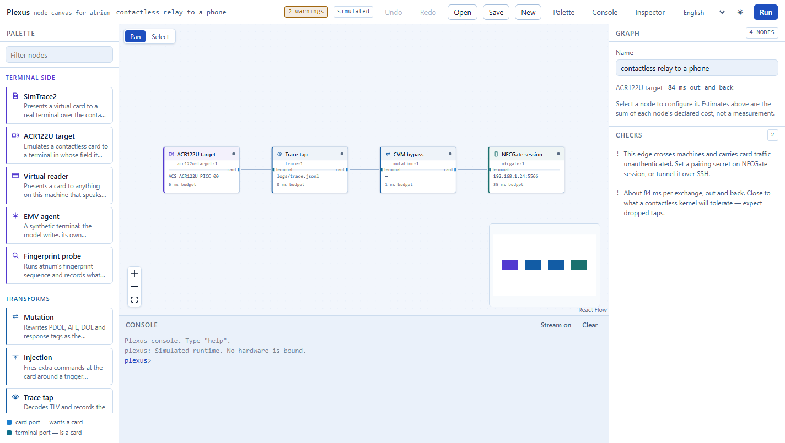
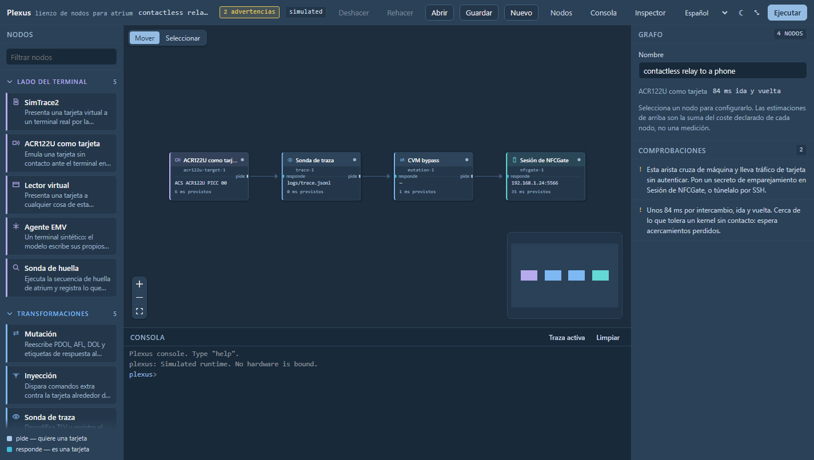
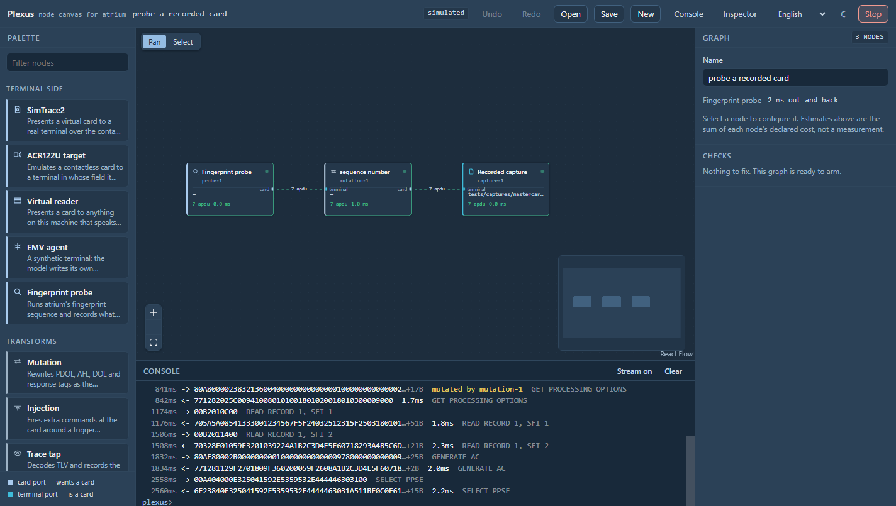
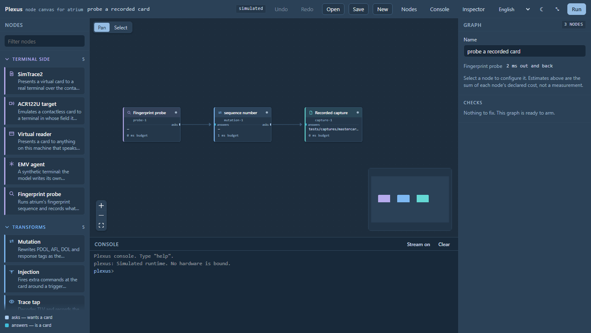
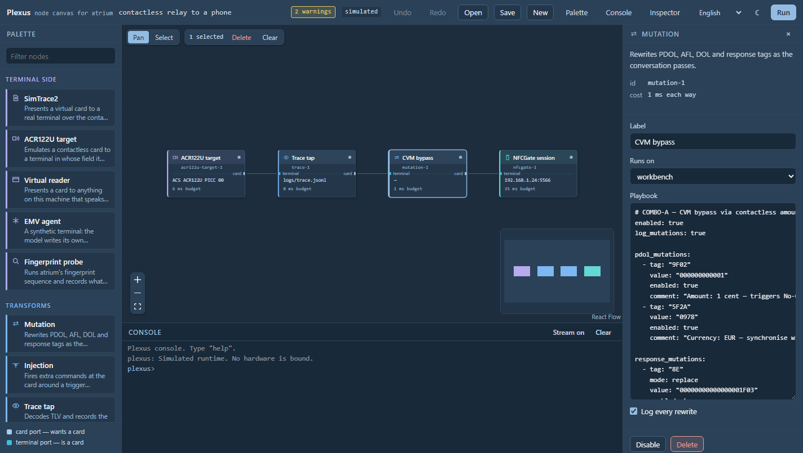

# Plexus

A node canvas for [atrium](https://github.com/salmg/atrium). Wire readers,
phones, captures and mutations into a relay you can see, run, and reach into
while it is running.

Designed and provided by **[academy.salmg.net](https://academy.salmg.net)**.
The full manual is in [docs/](docs/README.md).



> **Authorized use only.** For security research on cards, terminals and hosts
> you own or have written permission to test. Same terms as atrium.

Atrium can already do all of this. What it cannot do is *show* you the rig:
today a topology lives in a CLI flag soup (`--nfcgate --nfcgate-host … --reader
… --from-file …`) that is hard to read, harder to share, and impossible to see
the shape of. Plexus makes the rig the document.

---

## Quick start

You need **git**, **Python 3.8 or newer** and **Node.js 20.19+ or 22.12+**. Node
is only used once, to build the editor; after that only Python runs. You do not
need a reader, a phone or a card: the first rig below runs entirely on a
laptop.

**1. Clone it, with its submodule.** Atrium lives in `vendor/atrium`, which is
why the flag is there.

```bash
git clone --recurse-submodules https://github.com/salmg/plexus
cd plexus
```

If you already cloned without the flag: `git submodule update --init vendor/atrium`.
GitHub's **Download ZIP** never includes submodules, so a ZIP copy has an
empty `vendor/atrium` too; clone instead.

**2. Install the runtime into a virtual environment.**

```bash
python -m venv .venv
source .venv/bin/activate          # Windows PowerShell: .venv\Scripts\Activate.ps1
pip install -e ".[runtime]"
```

**3. Start it.**

```bash
plexus up
```

The first time, this runs `npm install` and `npm run build:bundle` in `ui/`.
That takes about a minute and is the only step that needs the network. Then it
prints:

```
Plexus on http://127.0.0.1:8900/
The editor and the runtime are both here. Ctrl-C to stop.
```

and opens your browser there. Opening the page arms nothing; **Run** is the
only thing that does.

**4. Check what is answering.** The top bar shows the runtime's address,
`127.0.0.1:8900/ws`. If it says **simulated** instead, you are looking at the
editor's built-in simulator, not a runtime that can bind a card. Nodes marked
with a dot in the palette need hardware or a daemon this machine does not have;
they can be drawn and checked here, and refuse when armed.



### Your first run, in a minute

The editor opens on an example relay to a phone, which names hardware a laptop
does not have. To run something real instead:

1. Press **Open** and pick `examples/probe-a-capture.plexus.yaml`. Plexus lists
   what the graph will claim, dial, and read or write before it loads anything.
   Press **Load**.
2. The checks panel says *Nothing to fix. This graph is ready to arm.* Press
   **Run**.
3. A fingerprint probe asks, a recorded capture answers, and atrium's mutation
   engine rewrites one tag between them. The node counters climb, the edges
   turn green, and the trace scrolls in the console.
4. Click into the console and type `status`, then `tx 00B2010C00`. That APDU
   crosses the same chain, so the last two lines show what the card said
   (`…5F3401`**`01`**`…`) and what the terminal was told
   (`…5F3401`**`07`**`…`).
5. Press **Stop** to release the capture.



To build that rig yourself from an empty canvas, follow
[Your first rig](docs/first-run.md).

### Using a card reader

The quick start leaves out the reader libraries on purpose, so a machine with
no reader needs no compiler. To bind a contact card in a PC/SC reader (an SCM
SCR3310, an Identiv, a Gemalto), add them:

**1. The PC/SC service and headers.** On Linux, pyscard builds from source, so
it needs these before pip can install it:

```bash
sudo apt install pcscd libpcsclite-dev swig python3-dev
```

On Windows and macOS the PC/SC service is built in, and pip usually finds a
ready-made pyscard.

**2. pyscard, into the same virtual environment as Plexus.** With `.venv`
active:

```bash
pip install -e ".[hardware]"
```

Installing it into another Python is the usual way to have pyscard and still
see no reader; the editor names the Python it is looking in.

**3. Restart `plexus up`**, add a **PC/SC reader** node from **Card side**, and
pick the reader in the inspector. If you plugged the reader in or installed
pyscard while the page was open, press **Look again** under the picker.

When the picker is empty it says why, in the runtime's words: atrium missing,
pyscard missing (and in which Python), pcscd not answering, or only atrium's
virtual reader (`Virtual PCD`, from vpcd) visible, which is never offered
because it is where atrium presents a card, not where one sits. `devices` in
the console and `plexus nodes` print the same sentence.

### Using a SimTrace2

A SimTrace2 puts a real payment terminal on the left of the chain: the board
sits in the terminal's card slot, and every command the terminal sends comes
through Plexus to whatever card the chain ends in, such as the PC/SC reader
above. It runs on Linux, and it needs three things Plexus checks for but never
starts:

1. **vpcd**, from the `virtualsmartcard` package, loaded into pcscd. `pcsc_scan`
   then lists `Virtual PCD 00 00`: that is where the terminal's commands arrive.
2. **The board on USB.** Under a VM, give the VM the USB device.
3. **simtrace2-remsim, running for the board, in a root shell.** It needs raw
   USB, so Plexus never launches it. The inspector prints the exact command for
   your board when the daemon is not up.

Then draw **SimTrace2 → (any transforms) → PC/SC reader**, pick the board and
the reader in the inspector, and press **Run**. Stop atrium's own relay first if
it is running: only one program at a time can answer vpcd. The picker, `devices`
in the console and `plexus nodes` say which of the three is missing.

A power cycle from the terminal is not passed on to the card, which stays open
for the whole run. See the caveats on the node, and
[Running on hardware](docs/hardware.md).

The ACR122U and virtual reader nodes can be drawn and checked, but their
pickers stay empty: they are not built yet, and the inspector says what each
one needs.

### Other ways to run it

| You want | Run | Needs |
| --- | --- | --- |
| The editor and a real runtime | `plexus up` | Python, and Node once |
| Only the editor, on its simulator, reloading as you edit it | `cd ui`, `npm install`, `npm run dev`, then open <http://localhost:5173> | Node |
| That dev server with a real runtime behind it | `plexus serve` in a second terminal, then open the URL it prints | Python and Node |
| Only the command line: check, show and run graph files | `pip install -e .`, then `plexus check <file>` | Python |
| The tests | `pip install -e ".[dev]"`, then `pytest` | Python |

`plexus up` takes `--port`, `--no-open` to skip the browser, and `--no-build`
to never run npm (it prints what to run instead). It binds loopback. Binding
any other address refuses to start without `PLEXUS_API_TOKEN` set, because an
open control plane for a card relay is not something to leave to a warning
nobody reads.

[Install](docs/install.md) has the detail behind each of these.

### If it does not start

- **`vendor/atrium` is empty, or the runtime cannot find atrium.** The clone
  skipped the submodule: `git submodule update --init vendor/atrium`. If your
  atrium checkout lives elsewhere, set `PLEXUS_ATRIUM=/path/to/atrium`.
- **`No editor to serve.`** npm is not on your PATH, or you passed
  `--no-build`. Install Node, or build once by hand:
  `cd ui && npm install && npm run build:bundle`.
- **The port is taken.** `plexus up --port 8901`.
- **`pcsc_scan` sees the reader and Plexus does not.** Read the sentence under
  the empty picker, or run `plexus nodes`. It is almost always pyscard missing
  from the Python that runs Plexus; see
  [Using a card reader](#using-a-card-reader).
- **A graph cannot find its capture or trace file.** Paths in a graph resolve
  inside the workspace, which is the directory you started `plexus` in. Start
  it from the repository root, or widen it with `PLEXUS_WORKSPACE`.
- **Windows, Git Bash says `Permission denied` running Python.** That is the
  Microsoft Store Python, which Git Bash cannot execute. Use PowerShell, or a
  python.org install.

More in [When it goes wrong](docs/troubleshooting.md).

---

## How it works

A graph is a chain that runs left to right: something that **asks** (a
terminal), any number of **transforms**, then something that **answers** (a
card).

1. **Draw** it. Drag or click nodes from the palette, wire a port that asks to
   a port that answers, and set each node's fields in the inspector. A wire
   that cannot work refuses to land and says why. See
   [An edge is a conversation](#an-edge-is-a-conversation).
2. **Check** it. The editor and the runtime apply the same rules, and a graph
   that fails them will not arm. See
   [What it checks before it will arm](#what-it-checks-before-it-will-arm).
3. **Run** it. Run binds what the graph names, drives the conversation, and
   streams every APDU into the console, with what each transform changed.
4. **Reach into** it. The console talks to the live process: send an APDU,
   pause, list the nodes. See [The console](#the-console).
5. **Save** it. A `.plexus.yaml` is the source of truth; the CLI reads the same
   file. See [From the command line](#from-the-command-line).

## An edge is a conversation

This is the one idea everything else follows from, and it is where a
node-graph tool for this domain usually goes wrong.

In n8n, or any dataflow editor, an edge is a one-way push and an execution
runs to completion. Neither is true here. A command APDU travels one way, a
response comes back along the same wire, and the graph stays up for thousands
of round trips until you stop it. So ports do not hold directions, they hold
roles:

- **requester**: I ask. Something on the other end has to answer.
- **responder**: I answer. I present myself as the thing being asked.

On the `apdu` channel those read as the **card port** (on the right: it wants a
card to talk to) and the **terminal port** (on the left: it behaves as a card
would). An edge is legal when two ports share a channel and hold opposite
roles, and it is always drawn requester → responder, the direction a command
travels.

```
  ACR122U target ──► Trace tap ──► Mutation ──► NFCGate session
   (asks)                                        (answers)
      card ●────────● terminal    card ●────────● terminal
```

The payoff is that a whole class of atrium's runtime errors become edges you
cannot draw. `transport/source.py` spends a paragraph explaining that the
reader presenting the emulated card cannot also hold the card being relayed,
because the failure that comes out of trying is a timeout rather than a
message. That is a rule about a graph. Here it is enforced when you reach for
the second node, with the reason on screen.

## What it checks before it will arm

- **Every requester is answered.** A node with nothing to ask cannot run.
- **No device is claimed twice.** A node does not contain a reader, it *binds*
  one, and the second claim is refused by name.
- **Cross-machine edges are authenticated.** An edge between two hosts that
  carries card traffic with no pairing secret is flagged, because the security
  model becomes a visible property of the picture rather than a README section.
- **The chain fits in a tap.** Each node declares what it costs; a contactless
  chain that sums past what a kernel will tolerate says so before you plug
  anything in. That threshold is a rule of thumb, not a figure from a
  specification, so it warns rather than refuses. See `TAP_BUDGET_WARN_MS`,
  which carries the reason there is one of it and not two.

A graph that fails these will not arm: Run greys out, the count in the top bar
turns red, and every check names the node it is about rather than describing a
category of problem.



## A graph is untrusted input

A `.plexus.yaml` is a document people send each other, and it names hardware to
claim, addresses to dial and files to read and write. Every one of the
following was measured open before it was closed, and each has a test in
`tests/test_security.py`.

**No page you visit can drive the runtime.** A browser does *not* apply the
same-origin policy to WebSockets. Any site could open `ws://127.0.0.1:8900/ws`,
and the Host header on that handshake is honestly `127.0.0.1:8900`, so
checking Host is not enough. A connection claiming
`Origin: https://evil.example.com` was accepted, and could have armed a card
relay. The Origin is now checked against an allow-list: loopback origins, plus
anything named in `PLEXUS_ALLOWED_ORIGINS`. A *missing* Origin is allowed,
because that is a native client, and this attack needs a browser.

**No graph can reach outside its workspace.** A trace node's `path` used to be
an arbitrary file write: appended JSON, anywhere the process could reach. Both
reads and writes now resolve inside a workspace, which is the directory the
runtime was started in, and anything escaping it is refused by name. Widen it
deliberately with `PLEXUS_WORKSPACE`; a graph cannot widen it for you.

**Nothing runs that a graph brings with it.** A playbook is YAML that reaches
atrium's loader, which uses `yaml.safe_load`: a tag asking for an object is an
error, not a call. Plexus parses the playbook first anyway, because atrium
*logs* a bad document and carries on with defaults, and a mutation node that
binds while silently doing nothing is worse than one that refuses.

**Sizes are bounded.** Frames over 1 MB are refused before being parsed, and an
APDU larger than a card could read is refused before it becomes bytes.

**Opening a graph is not agreeing to it.** Open shows what the graph will
claim, dial and write, and loads nothing until you say so. That is an
informed-consent step, not a boundary. The boundary is the workspace and the
checks, which do not depend on anyone reading a dialog.



Still true, and deliberate: **there is no authentication on loopback.** Same
position atrium takes: the operating system already decides who can open a
local socket. Binding anywhere else refuses to start without
`PLEXUS_API_TOKEN`.

## Light and dark

It follows your system theme, and the toggle in the top bar overrides it. The
light palette is a set of blues rather than a washed-out version of the dark
one; both were measured against WCAG on every surface they use.



## English and Spanish

Pick a language in the top bar; it is remembered, and a first visit follows the
browser's own preference. Everything the editor writes moves with it, including
the parts it generates rather than stores: the checks, the reason a wire was
refused, the node titles and the port labels on the cards.

The runtime's own words stay in English: they arrive already written, over the
socket, and translating half a trace would be worse than leaving it whole.
Adding a third language is one file and no framework. See
[docs/languages.md](docs/languages.md).



## The console

Dark mode is not a color scheme, it is the working mode: the canvas dims and a
real terminal sits under it. Its palette comes from
[academy.salmg.net](https://academy.salmg.net)'s own, a deep blue-slate ground
rather than black, so the two read as one operation. During a relay the useful
thing is rarely reading the trace; it is reaching into the running process.

```
plexus> tx 80CA9F1700
plexus> nodes
acr122u-target-1         1284 apdu     6.2 ms
mutation-1               1284 apdu     1.1 ms
nfcgate-1                1284 apdu    34.8 ms
plexus> pause
```

`help` lists the rest: `status`, `nodes`, `edges`, `devices`, `pause`,
`resume`, `check`. The same console works against the simulator and against a
card, because both answer the same protocol.



---

## From the command line

The graph model and the checks run headless, with only PyYAML installed: no
Node, no browser, no editor.

```bash
pip install -e .
plexus check examples/contactless-relay.plexus.yaml
plexus show  examples/contactless-relay.plexus.yaml
plexus nodes
```

`show` prints the chain and what it is expected to cost:

```
contactless relay to a phone

  ├─ ACR122U target  (acr122u.target, 6 ms)  @workbench
  ├─ Trace tap  (trace, 0 ms)  @workbench
  ├─ CVM bypass  (mutation, 1 ms)  @workbench
  └─ NFCGate session  (nfcgate, 35 ms)  @phone

  42 ms each way, 84 ms out and back.
```

And `run` arms the graph for real. It needs the submodule checked out, and the
same rig as the first run above needs nothing else:

```bash
plexus run examples/probe-a-capture.plexus.yaml
```

```
info  Armed 3 nodes: probe-1 -> mutation-1 -> capture-1
    31.2 -> 00A404000E325041592E5359532E444446303100
    32.6 <- 6F20840E325041592E5359532E4444463031A50E…9000  1.4 ms
    32.8 -> 00A4040007A000000004101000
    34.1 <- 6F178407A0000000041010A50C500A4D61737465…9000  1.3 ms
    34.2 -> 80A8000002830000
    34.2 <- 770A82021C009404080101009000  0.0 ms
    34.3 -> 00B2010C00
    34.3 <- 70145A0854133300123456785F24032512315F3401019000  0.0 ms
    34.4 <- 70145A0854133300123456785F24032512315F3401079000  rewritten by mutation-1

4 exchanges, 0 errors.
```

The last two lines are the point: what the card said, and what the terminal was
told. `plexus nodes` marks which node types this build can actually bind; the
rest name the hardware or daemon they need and refuse at bind time.

The same rig in the editor, where the checks say up front what the CLI can only
prove by running it. *Nothing to fix, this graph is ready to arm*:



## Layout

```
ui/                     the editor (React, @xyflow/react, xterm.js)
  src/graph/            model, validation, YAML
  src/catalogue/        node types: data, never code
  src/runtime/          mock runtime, WebSocket runtime
  src/canvas/           React Flow canvas and the node card
  src/panels/           palette, inspector, console
  scripts/              catalogue export, and the screenshots in docs/images
plexus/                 the runtime (Python)
  graph.py              the model again, and the same checks
  catalogue.py          reads the catalogue below, wherever it is installed
  schema/catalogue.json generated: the one description of every node type
  runtime/              engine, the chain, the frames it emits
  nodes/                card / terminal / transform implementations
  adapters/             the only place that imports atrium
  api/                  the WebSocket server (PROTOCOL.md)
  cli.py                check, show, run, up, serve, nodes
examples/               rigs you can open and one you can run
tests/                  the model, and the engine end to end
vendor/atrium/          submodule, never edited
PROTOCOL.md             the WebSocket contract between the two
```

The screenshots regenerate from `ui/`: `npm run screenshots` captures the
simulator shots, and with `plexus up --no-open` running from the repository
root, `node scripts/screenshots.mjs --live http://127.0.0.1:8900/` captures the
two of the real runtime.

### One catalogue, two readers

A node type's ports, config fields and latency cost are described once, in
`ui/src/catalogue/index.ts`, and exported to `plexus/schema/catalogue.json` with
`npm run export:catalogue`. The Python side loads that file. Writing the table
twice would guarantee drift, and the first symptom would be a graph that draws
in the editor and refuses to run, or worse, runs differently.

### Atrium is a submodule, not a fork

`vendor/atrium` is pinned at a commit and never edited. Upgrades are an
explicit bump you can review:

```bash
git submodule update --remote vendor/atrium
```

Every node in the catalogue maps onto something that already exists there: a
`CardTransport` implementation, a `SmartcardOS`, or the `on_command` /
`on_response` pair the mutation engine exposes. A mutation node's config *is*
an atrium playbook: the files in `vendor/atrium/playbooks/` paste in unchanged.



## What is not built yet

Being straight about the line:

- **The hardware nodes.** The engine binds, drives, rewrites, reports and
  releases. The cards it binds today are a recorded capture and a contact card
  in a **PC/SC reader** (`pip install -e ".[hardware]"`, then plug one in; it
  is discovered and appears in the editor's reader picker). The terminals are
  the fingerprint probe, the EMV agent, and a real terminal through a
  **SimTrace2** (see [Using a SimTrace2](#using-a-simtrace2)); the SimTrace2
  relay is tested from vpcd inwards, and the board and daemon half has still to
  be run on a rig. The ACR122U in either mode, NFCGate, the card proxy and vpcd
  all resolve, and all refuse at bind time naming what they need. They are
  adapter work against seams that already exist in atrium (PC/SC and SimTrace2
  are the worked examples of that work), and they need the rig to be worth
  writing.
- **Host-layer nodes.** ISO 8583 is a second channel in the model (`iso8583`)
  with no nodes on it yet. The interesting one is a DE55 bridge, where the two
  halves atrium describes actually meet.

### Why a laptop can run a whole graph

Atrium splits cleanly in half, and only one half needs hardware.
`mutation_engine`, `transport.recorded`, `emv_logger` and `card_fingerprint`
are pure standard library: they import with no reader attached and no pyscard
installed. So a graph made of a capture and some transforms is a complete,
honest relay that runs anywhere, and that is what the test suite drives: bind,
drive, rewrite, report, release, through atrium's real mutation engine.

Everything Plexus asks of atrium it found rather than invented.
`CardTransport` is connect / get_atr / transmit / disconnect, which is exactly
a card-side node. `MutationEngine` is `on_command(cmd) -> cmd` and
`on_response(cmd, resp) -> resp`, which is exactly a transform. All of it goes
through `plexus/adapters/`, and nothing else in the codebase imports atrium.

### The two implementations have to agree

The editor and the runtime apply the same rules to the same graph, in different
languages. `tests/test_graph.py` pins the places where that agreement is
observable: the example rig's 84 ms round trip, its two warnings, the chain
order, so a change to one side that quietly disagrees with the other fails a
test rather than surfacing as a graph that draws fine and runs differently.

One case is worth keeping: `test_the_thresholds_are_reachable_by_a_graph_someone_could_draw`
is a regression on a check that did nothing. The contactless timing thresholds
were first compared against the one-way sum at 120/300 ms, while the dearest
chain the catalogue allows is 43 ms one way, so the warning could never fire
and the error needed 79 stacked mutation nodes. They now measure the round trip
against 60/150 ms, and the test fails if the catalogue ever drifts back out of
their reach.
