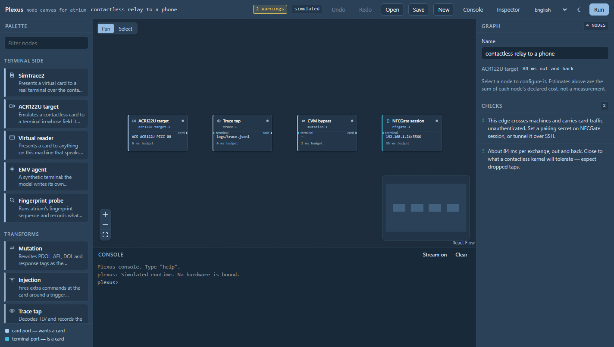

# Plexus — the manual

A node canvas for [atrium](https://github.com/salmg/atrium). You draw the rig;
Plexus checks it, runs it, and lets you reach into it while it runs.

Designed and provided by **[academy.salmg.net](https://academy.salmg.net)**.

> **Authorized use only.** For security research on cards, terminals and hosts
> you own or have written permission to test. Same terms as atrium.



---

## Start here

| | |
|---|---|
| **[Install](install.md)** | Get it running. Fifteen minutes, no hardware needed. |
| **[Your first rig](first-run.md)** | Build and run a relay end to end on a laptop. |
| **[The node reference](nodes.md)** | What each of the fifteen nodes is, and what it needs. |
| **[Running on hardware](hardware.md)** | The Python runtime, the rig, what is not built yet. |
| **[What it refuses](security.md)** | The checks, the workspace, and why a web page cannot drive it. |
| **[Languages](languages.md)** | English and Spanish, and how to add a third. |
| **[When it goes wrong](troubleshooting.md)** | The failures that look like something else. |

**En español:** [Instalación](es/install.md) · [Tu primer montaje](es/first-run.md)

---

## The one idea

Everything else follows from this, and it is where a node-graph tool for this
domain usually goes wrong.

In n8n — or any dataflow editor — an edge is a one-way push and an execution
runs to completion. Neither is true here. A command APDU travels one way, a
response comes back along the same wire, and the graph stays up for thousands
of round trips until you stop it.

So ports do not hold directions. They hold **roles**:

- **requester** — I ask. Something on the other end has to answer.
- **responder** — I answer. I present myself as the thing being asked.

On the APDU channel those read as the **card port** (it wants a card to talk
to) and the **terminal port** (it behaves as a card would). An edge is legal
when two ports share a channel and hold opposite roles, and it is always drawn
requester → responder — the direction a command travels.

```
  ACR122U target ──► Trace tap ──► Mutation ──► NFCGate session
   (asks)                                        (answers)
      card ●────────● terminal    card ●────────● terminal
```

The payoff is that a whole class of atrium's run-time errors become edges you
cannot draw. `transport/source.py` spends a paragraph explaining that the
reader presenting the emulated card cannot also hold the card being relayed,
because the failure that comes out of trying is a timeout rather than a
message. That is a rule about a graph. Here it is enforced when you reach for
the second node, with the reason on screen.

## What the two halves are

Plexus is an **editor** and a **runtime**, and they are useful separately.

The **editor** is a web app. It draws graphs, checks them, saves and loads
`.plexus.yaml` files, and ships a simulator so the whole interface works with
no reader attached and no Python installed. That is where you start.

The **runtime** is Python. It reads the same graph, re-checks it, binds what it
names and moves APDUs along it. It imports atrium through one narrow adapter
layer and never edits it.

They meet over one WebSocket, specified in
[PROTOCOL.md](../PROTOCOL.md). The top bar always says which runtime is
answering, so a simulated result is never mistaken for a card.

## Being straight about what is finished

- The editor is finished enough to use, in English and Spanish.
- The runtime binds a **recorded capture** and drives it with the
  **fingerprint probe**, through real transforms including atrium's own
  mutation engine. That is a complete relay, and it runs on a laptop.
- Every **hardware** node — PC/SC, the ACR122U in either mode, NFCGate, the
  card proxy, SimTrace2, vpcd — resolves in a graph and **refuses at bind
  time, naming what it needs**. Those adapters are the next piece of work.
- The **host layer** (ISO 8583) exists as a second channel in the model with
  no nodes on it yet.

See [Running on hardware](hardware.md) for exactly where that line falls.

---

Plexus is designed and provided by **[academy.salmg.net](https://academy.salmg.net)**,
which is also where the training material for this kind of work lives.
