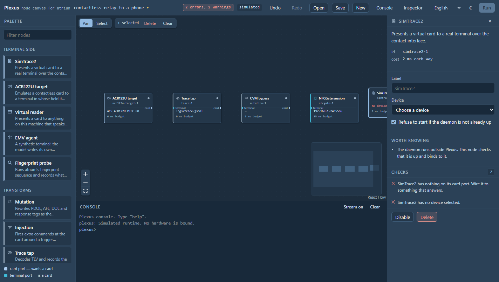
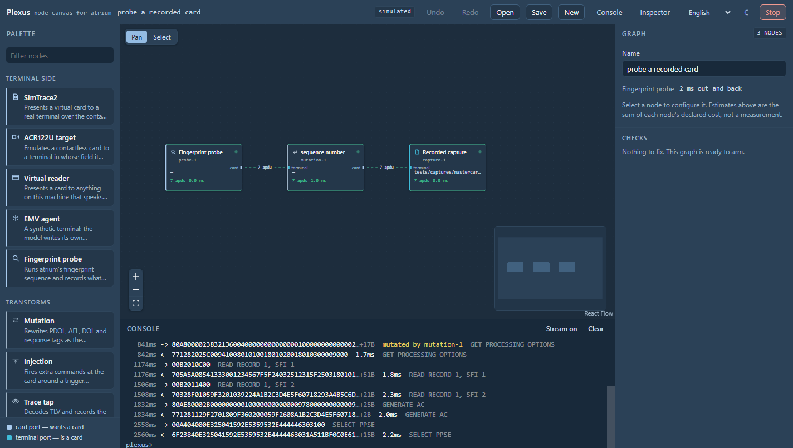
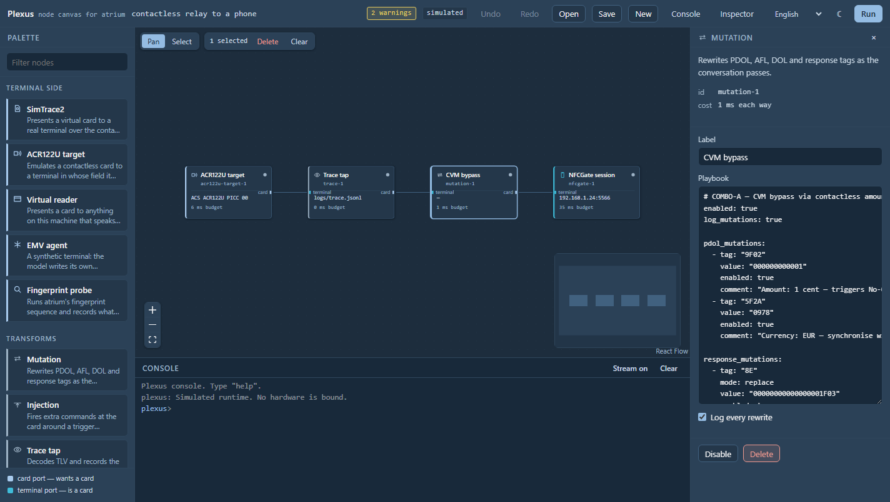

# Tu primer montaje

Monta un relé que funcione partiendo de cero, ejecútalo y métete dentro — en un
portátil, sin lector y sin tarjeta. Diez minutos.

Necesitas el editor en marcha. Si no lo tienes, haz el paso 2 de
[Instalación](install.md).

---

## 1. Vacía el lienzo

El editor abre con un ejemplo. Pulsa **Nuevo** para empezar de cero.

La pista te dice la forma de lo que vas a montar:

> Una cadena va de izquierda a derecha: algo que pide, las transformaciones que
> quieras y, al final, algo que responde.

Ese es el modelo entero. Los nodos vienen en tres clases, y la paleta está
agrupada por ellas:

- **Lado del terminal** — nodos que sólo piden. Van a la izquierda.
- **Transformaciones** — hacen las dos cosas. Van en medio, tantas como quieras.
- **Lado de la tarjeta** — nodos que sólo responden. Van a la derecha.

## 2. Algo que pida

En **Lado del terminal**, pulsa **Sonda de huella**.

Cae en el lienzo con el borde rojo, y el panel de comprobaciones dice por qué:

> Sonda de huella no tiene nada en su puerto tarjeta. Conéctalo a algo que
> responda.

**Ejecutar** está desactivado, y al pasar por encima dice *«Corrige primero los
errores de la lista de comprobaciones»*. Ese es el trato que hace Plexus: un
grafo que fallaría como un tiempo de espera agotado o como una avería de
hardware falla aquí, con una frase.



## 3. Algo que responda

En **Lado de la tarjeta**, pulsa **Captura grabada**.

Ahora conéctalos: arrastra desde el puerto **tarjeta** de la sonda — el
cuadradito de su derecha — hasta el puerto **terminal** de la captura, a su
izquierda.

Prueba primero a hacerlo mal, que es instructivo. Arrastra del puerto tarjeta de
la sonda a *otro* puerto tarjeta y el cable se niega a aterrizar, con el motivo
en pantalla:

> Los dos puertos piden. Una arista une uno que pide con uno que responde.

## 4. Apunta la captura a un fichero

Pulsa el nodo de la captura. El inspector de la derecha muestra sus campos.

Pon **Fichero de captura** a:

```
tests/captures/mastercard-probe.jsonl
```

Es una captura pequeña que viene con el repositorio y que responde exactamente
la secuencia que manda la sonda.

> Las rutas son relativas al **espacio de trabajo** del runtime: el directorio
> desde el que se arrancó. Un grafo no puede salir de ahí. Ver
> [What it refuses](../security.md).

El panel de comprobaciones debería decir ya **Nada que corregir. Este grafo se
puede armar.**

## 5. Ejecútalo

Pulsa **Ejecutar**.



Lee lo que ha pasado:

- Cada nodo muestra un contador y una media — `4 apdu`, `0.0 ms`.
- Cada arista lleva una etiqueta: cuántos APDU la han cruzado.
- La consola muestra el intercambio, comando y respuesta, con su tiempo.
- Los bordes de los nodos se pusieron verdes mientras pasaba tráfico.

Eso es un relé completo. La sonda seleccionó el directorio, seleccionó la
aplicación que anunciaba la tarjeta, pidió las opciones de proceso y leyó el
registro al que apuntaba su AFL.

## 6. Cambia lo que dice la tarjeta

Añade un nodo **Mutación** desde **Transformaciones** y recablea la cadena para
que quede en medio: sonda → mutación → captura.

Púlsalo y sustituye el **Playbook** por esto:

```yaml
enabled: true
log_mutations: false

pdol_mutations: []
afl_mutations: []
dol_mutations: []
injected_commands: []

response_mutations:
  - tag: "5F34"
    mode: replace
    value: "07"
    enabled: true
    comment: "PAN sequence number"
```

Vuelve a pulsar **Ejecutar** y mira las dos últimas líneas de la traza:

```
<- 70145A0854133300123456785F24032512315F3401019000    0.0 ms
<- 70145A0854133300123456785F24032512315F3401079000    rewritten by mutation-1
```

`5F34 01 01` de la tarjeta; `5F34 01 07` al terminal. Se muestran las dos,
porque la diferencia entre lo que respondió una tarjeta y lo que le contaron al
terminal es justo lo que estás buscando.

> **Ese playbook es el formato de atrium, sin cambios.** Los ficheros de
> `vendor/atrium/playbooks/` se pegan directamente en ese campo.



Con el nodo seleccionado, lee **Conviene saber**, debajo de los campos. Todo
nodo que tenga una trampa la dice ahí: el byte de UID que fuerza el ACR122U, el
límite de 253 bytes por trama, la ida y vuelta que una inyección gasta dos veces.

## 7. Métete dentro

Abre la **Consola** si está cerrada. Con el grafo en marcha, escribe:

```
status
```

```
runtime   plexus
state     running
graph     untitled
chain     probe-1 -> mutation-1 -> capture-1
budget    1 ms each way, 2 ms out and back
```

Y manda un APDU a mano:

```
tx 00B2010C00
```

```
-> 00B2010C00
<- 70145A0854133300123456785F24032512315F3401019000
```

Ha ido por la misma cadena, ha cogido el mismo cerrojo que el conductor, y sale
en los contadores de los nodos. Con `help` ves el resto: `nodes`, `edges`,
`devices`, `pause`, `resume`, `check`.

> Una sonda que acaba **no ha parado**. La tarjeta sigue reservada para que `tx`
> siga funcionando; los nodos pasan de *hay tráfico* a *reservado* y el runtime
> se queda en `running` hasta que pulses Detener.

## 8. Guárdalo

Pulsa **Guardar**. Obtienes un `.plexus.yaml`, el mismo formato que lee la CLI:

```bash
plexus check untitled.plexus.yaml
plexus show  untitled.plexus.yaml
plexus run   untitled.plexus.yaml
```

El fichero es la fuente de verdad. El editor es una forma de escribirlo y el
runtime una de leerlo, y ninguno de los dos es su dueño.

---

## Qué leer después

- **[The node reference](../nodes.md)** — los otros trece nodos.
- **[Running on hardware](../hardware.md)** — cuando quieras una tarjeta de
  verdad.
- **[What it refuses](../security.md)** — por qué Abrir pregunta antes de
  cargar, y qué es el espacio de trabajo.

## Dos cosas que conviene saber ya

**Selección con el ratón.** El lienzo tiene un conmutador **Mover /
Seleccionar**. En modo Seleccionar, arrastrar dibuja un recuadro: encierra unos
nodos, arrastra cualquiera de ellos para mover el grupo, y Eliminar se los lleva
con sus cables en un solo paso de deshacer. Para desplazar el lienzo, botón
central o derecho.

**El presupuesto de tiempo.** Cada nodo declara lo que cuesta, y las
comprobaciones lo suman **ida y vuelta**, que es el intervalo que mide de verdad
un terminal. Una cadena con un móvil dentro sale a unos 84 ms y avisa; un relé
local con dos lectores sale a 30 ms y se calla. Esos umbrales son reglas de
andar por casa, no cifras de una especificación, y lo dicen.

---

Diseñado y facilitado por **[academy.salmg.net](https://academy.salmg.net)**.
