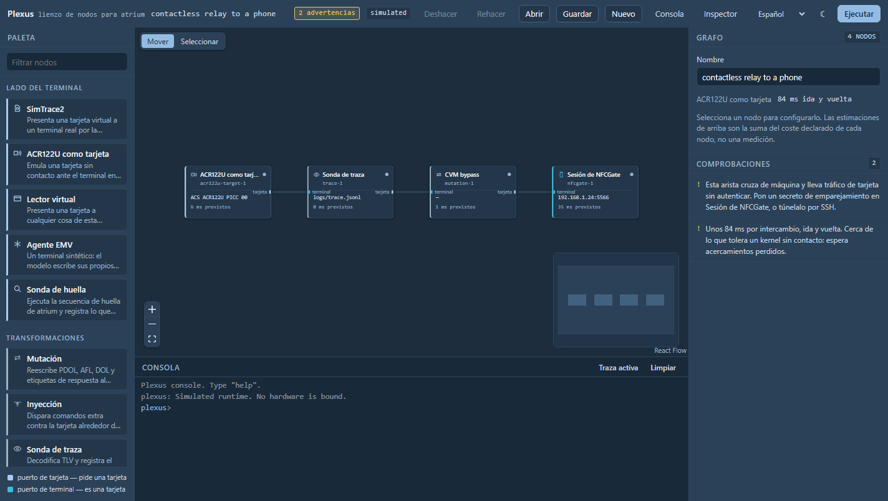

# Instalación

Dos mitades, y con la primera ya llegas a algún sitio.

- **El editor** necesita Node 20 o posterior. Nada más: ni lector, ni Python.
- **El runtime** necesita Python 3.8 o posterior, y sólo cuando quieras armar
  un grafo de verdad.

Haz el editor primero. Trae un simulador, así que puedes montar un grafo,
ejecutarlo y leer la traza antes de decidir si te merece la pena el resto.

---

## 1. Bájate el código

Plexus lleva atrium como submódulo de git, así que clona con él:

```bash
git clone --recurse-submodules https://github.com/salmg/plexus
cd plexus
```

Si ya lo clonaste sin `--recurse-submodules`:

```bash
git submodule update --init vendor/atrium
```

`vendor/atrium` está fijado a un commit y **nunca se edita**. Actualizarlo es un
paso explícito y revisable:

```bash
git submodule update --remote vendor/atrium
```

## 2. El editor

```bash
cd ui
npm install
npm run dev
```

Abre <http://localhost:5173> y elige **Español** en la barra superior.

Deberías ver el montaje de ejemplo, y la barra superior debería decir
**simulated**:



Esa etiqueta importa. Es como sabes que nada está tocando hardware — y, más
adelante, como sabes que algo sí.

### Comprobar que funciona

Pulsa **Ejecutar**. El simulador empuja una transacción sin contacto plausible
por la cadena que haya dibujada: verás subir los contadores de los nodos,
ponerse verdes las aristas y correr la traza en la consola.

Pulsa **Detener**. Si eso funcionó, el editor está instalado.

> Los APDU que manda el simulador son **ilustrativos, no una captura**. Las
> estructuras tienen la forma de las de verdad, para que la traza se lea bien a
> quien conoce EMV, pero ninguna tarjeta emitió esos bytes y no hay que
> concluir nada de ellos.

## 3. El runtime

Sólo hace falta para armar un grafo de verdad. El modelo, las comprobaciones y
la CLI no necesitan más que PyYAML:

```bash
cd ..            # de vuelta a la raíz del repositorio
pip install -e .
```

Compruébalo:

```bash
plexus nodes
```

```
   capture            card       terminal(answers)                  Recorded capture
 · pcsc               card       terminal(answers)                  PC/SC reader
   probe              terminal   card(asks)                         Fingerprint probe
   mutation           transform  terminal(answers) card(asks)       Mutation
   ...

· needs hardware or a daemon this build cannot start; the rest run anywhere.
```

El punto es la parte honesta: esos nodos se resuelven dentro de un grafo y se
niegan al armarlo, diciendo qué les falta.

> La CLI y el runtime hablan **en inglés**. Lo que dicen llega ya escrito por el
> socket, y traducir media traza sería peor que dejarla entera en un idioma.
> Ver [Idiomas](../languages.md).

Ahora ejecuta un montaje que no necesita nada:

```bash
plexus run examples/probe-a-capture.plexus.yaml
```

```
info  Armed 3 nodes: probe-1 -> mutation-1 -> capture-1
    31.2 -> 00A404000E325041592E5359532E444446303100
    32.6 <- 6F20840E325041592E5359532E4444463031A50E…9000  1.4 ms
    ...
    34.3 <- 70145A0854133300123456785F24032512315F3401019000  0.0 ms
    34.4 <- 70145A0854133300123456785F24032512315F3401079000  rewritten by mutation-1
```

Esas dos últimas líneas son lo importante: lo que dijo la tarjeta y lo que le
contaron al terminal. La reescritura la hace el motor de mutaciones de atrium,
no una imitación.

### El servidor al que se conecta el editor

```bash
pip install -e ".[runtime]"
plexus serve
```

```
Plexus runtime on ws://127.0.0.1:8900/ws
Point the editor at it:  http://localhost:5173/?runtime=ws://127.0.0.1:8900/ws
```

Abre esa segunda URL. La barra superior pasa de **simulated** a
`127.0.0.1:8900/ws`, Ejecutar arma el grafo de verdad, y la consola llega hasta
dentro.

`serve` escucha en loopback. Escuchar en cualquier otra dirección **se niega a
arrancar** sin un token — ver [What it refuses](../security.md).

## 4. Opcional: las pruebas

```bash
pip install -e ".[dev]"
pytest
```

90 pruebas: el modelo, las comprobaciones, el motor de punta a punta contra una
captura grabada, el protocolo WebSocket, y cada agujero que se ha encontrado y
cerrado.

---

## Notas por plataforma

**Windows.** Todo lo anterior funciona. Para el runtime, ojo: Git Bash **no
puede ejecutar** un Python de la Microsoft Store — sale `Permission denied`, que
se lee exactamente igual que si no estuviera instalado. Usa PowerShell, o un
Python de python.org.

**La mitad del hardware necesita Linux.** No es cosa de Plexus: ahí viven
`pcscd`, `vpcd` y `simtrace2-remsim`, y la propia guía de atrium lo da por
supuesto. Dibujar y comprobar un grafo se hace en cualquier sitio; armarlo, allí
donde estén los lectores.

**Bancos de trabajo sin red.** El editor no descarga nada en ejecución: ni
fuentes web, ni iconos de CDN, ni analítica. `npm install` es el único paso que
necesita red, y se puede hacer en otra máquina y copiar.

---

Siguiente: **[Tu primer montaje](first-run.md)**.

---

Diseñado y facilitado por **[academy.salmg.net](https://academy.salmg.net)**.
