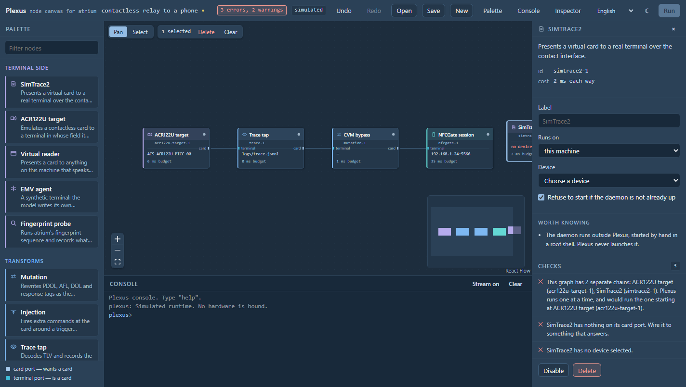
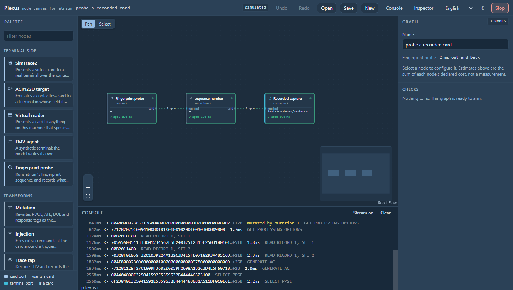
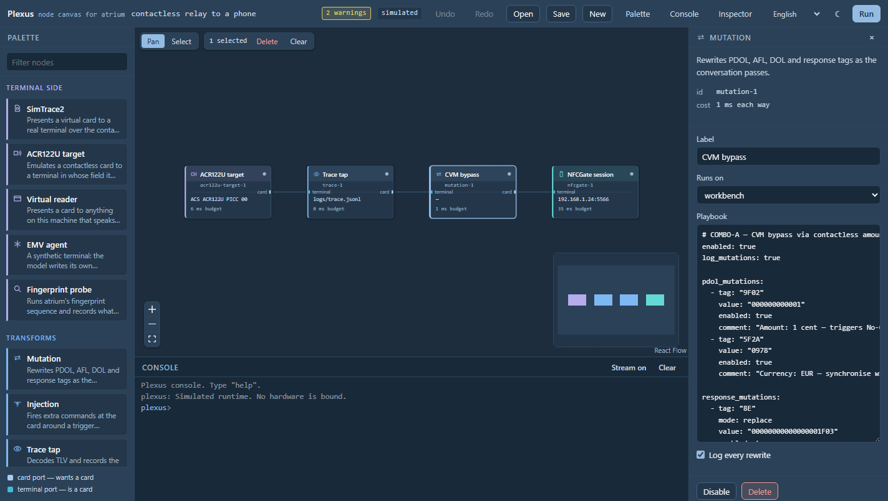

# Your first rig

Build a working relay from nothing, run it, and reach into it — on a laptop,
with no reader and no card. Ten minutes.

You need **both halves** running — the editor and the runtime:

```bash
cd ui && npm run dev            # one terminal
pip install -e ".[runtime]"     # another
plexus serve
```

Then open the URL `serve` prints, the one with `?runtime=` in it. The top
bar should say `127.0.0.1:8900/ws` rather than **simulated**.

The editor alone ships a simulator, and the simulator is enough to draw a
graph and watch invented traffic cross it. It is not enough for this guide:
from step 4 on, the card is a *file*, and reading a file is the runtime's
job. See [Install](install.md) steps 2 and 3.

---

## 1. Clear the canvas

The editor opens on an example. Press **New** to start from nothing.

The hint tells you the shape of what you are about to build:

> A chain runs left to right: something that asks, any number of transforms,
> then something that answers.

That is the whole model. Nodes come in three kinds, and the palette is grouped
by them:

- **Terminal side** — nodes that only ask. They go on the left.
- **Transforms** — nodes that do both. They go in the middle, any number.
- **Card side** — nodes that only answer. They go on the right.

## 2. Something that asks

From **Terminal side**, click **Fingerprint probe**.

It lands on the canvas with a red outline, and the checks panel says why:

> Fingerprint probe has nothing on its card port. Wire it to something that
> answers.

**Run** is disabled, and hovering it says *"Fix the errors in the checks list
first"*. That is the deal Plexus makes: a graph that would fail as a timeout or
a hardware fault fails here instead, with a sentence.



## 3. Something that answers

From **Card side**, click **Recorded capture**.

Now wire them: drag from the probe's **card** port — the square on its right —
to the capture's **terminal** port on its left.

Try the wrong thing first, it is instructive. Drag from the probe's card port to
*nothing*, or to another card port, and the wire refuses to land with the reason
on screen:

> Both ports ask. An edge joins one that asks to one that answers.

## 4. Point the capture at a file

Click the capture node. The inspector on the right shows its fields.

Set **Capture file** to:

```
tests/captures/mastercard-probe.jsonl
```

That is a small capture that ships with the repository and answers exactly the
sequence the probe sends.

> Paths are relative to the runtime's **workspace** — the directory it was
> started in. A graph cannot reach outside it. See
> [What it refuses](security.md).

The checks panel should now say **Nothing to fix. This graph is ready to arm.**

## 5. Run it

Press **Run**.



Read what happened:

- Each node shows a count and a mean — `4 apdu`, `0.0 ms`.
- Each edge carries a label: how many APDUs crossed it.
- The console shows the exchange, command and response, with the timing.
- The node borders went green while traffic was crossing, then settled.

That is a complete relay. The probe selected the directory, selected the
application the card advertised, asked for processing options, and read the
record its AFL pointed at.

## 6. Change what the card says

Add a **Mutation** node from **Transforms**, and rewire the chain so it sits in
the middle: probe → mutation → capture.

Click it, and replace the **Playbook** with:

```yaml
enabled: true
log_mutations: false

pdol_mutations: []
afl_mutations: []
dol_mutations: []
injected_commands: []

response_mutations:
  - tag: "5F34"
    mode: replace
    value: "07"
    enabled: true
    comment: "PAN sequence number"
```

Press **Run** again, and watch the last two lines of the trace:

```
<- 70145A0854133300123456785F24032512315F3401019000    0.0 ms
<- 70145A0854133300123456785F24032512315F3401079000    rewritten by mutation-1
```

`5F34 01 01` from the card; `5F34 01 07` to the terminal. Both are shown,
because the difference between what a card answered and what a terminal was
told is the thing you are actually looking for.

> **That playbook is atrium's format, unchanged.** Files in
> `vendor/atrium/playbooks/` paste straight into this field.



While the node is selected, read **Worth knowing** below the fields. Every node
that has a catch states it there — the ACR122U's forced UID byte, the 253-byte
frame limit, the round trip an injection spends twice.

## 7. Reach into it

Open the **Console** if it is closed. With the graph running, type:

```
status
```

```
runtime   plexus
state     running
graph     untitled
chain     probe-1 -> mutation-1 -> capture-1
budget    1 ms each way, 2 ms out and back
```

Then send an APDU by hand:

```
tx 00B2010C00
```

```
-> 00B2010C00
<- 70145A0854133300123456785F24032512315F3401019000
```

That went through the same chain, took the same lock as the driver, and shows
up in the node counters. `help` lists the rest — `nodes`, `edges`, `devices`,
`pause`, `resume`, `check`.

> A probe that finishes has not stopped. The card stays bound so `tx` keeps
> working; the nodes go from *live* to *ready* and the runtime stays
> **running** until you press Stop.

## 8. Save it

Press **Save**. You get a `.plexus.yaml` — the same format the CLI reads:

```bash
plexus check untitled.plexus.yaml
plexus show  untitled.plexus.yaml
plexus run   untitled.plexus.yaml
```

The file is the source of truth. The editor is one way to write it and the
runtime is one way to read it, and neither owns it.

---

## What to read next

- **[The node reference](nodes.md)** — the other thirteen nodes.
- **[Running on hardware](hardware.md)** — when you want a real card.
- **[What it refuses](security.md)** — why Open asks before it loads, and what
  the workspace is.

## Two things worth knowing now

**Mouse selection.** The canvas has a **Pan / Select** toggle. In Select mode a
plain drag draws a box; box a few nodes, drag any one of them to move the
group, and Delete removes them and their wires as one undo step. Panning moves
to the middle and right mouse buttons.

**The timing budget.** Each node declares what it costs, and the checks add it
up as a **round trip** — the interval a terminal actually times. A chain with a
phone in it comes to about 84 ms and warns; a local two-reader relay comes to
30 ms and stays quiet. Those thresholds are rules of thumb, not figures from a
specification, and they say so.
