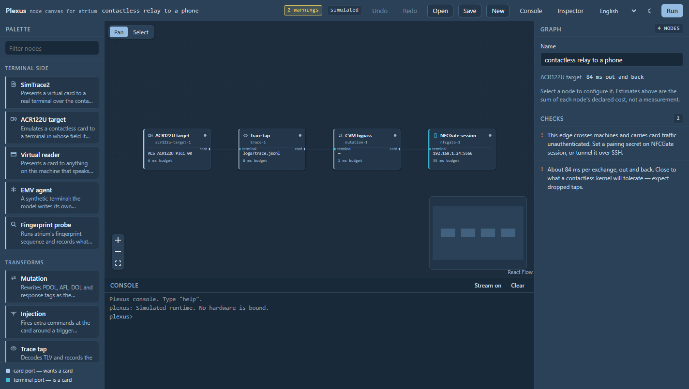
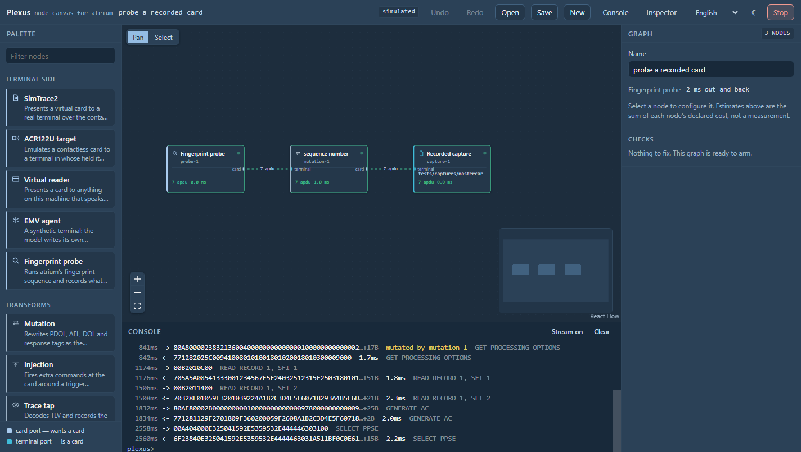

# Install

One command runs everything. Two more fetch it first.

```bash
git clone --recurse-submodules https://github.com/salmg/plexus
cd plexus
pip install -e ".[runtime]"
plexus up
```

The first run builds the editor, which takes a minute and needs the network
once. After that:

```
The editor has not been built here yet. Building it once:
    npm install
    npm run build:bundle

    ...

Plexus on http://127.0.0.1:8900/
The editor and the runtime are both here. Ctrl-C to stop.
```

A browser opens there. The top bar says `127.0.0.1:8900/ws` rather than
**simulated**, which is how you know what is behind **Run**: a runtime that can
bind real hardware, not the simulator the editor carries on its own.

Opening the page arms nothing. **Run** is the only thing that arms a graph, and
it is a button you press.

## What it needs

- **Python 3.8 or newer** — the runtime, the checks and the CLI.
- **Node 22.12 or newer** — to build the editor, once. 20.19+ builds
  everything except `npm run export:catalogue`, which imports TypeScript
  directly and wants 22.18.
- **A reader, a phone or a SimTrace2** — only for the nodes that touch
  hardware, and only when you arm one. Everything else runs on a laptop.

`vendor/atrium` is a git submodule, which is why the clone above says
`--recurse-submodules`. If you already cloned without it:

```bash
git submodule update --init vendor/atrium
```

It is pinned at a commit and **never edited**. Upgrading it is an explicit,
reviewable step:

```bash
git submodule update --remote vendor/atrium
```

If your atrium checkout lives somewhere else entirely, say where and nothing
else changes:

```bash
export PLEXUS_ATRIUM=/path/to/atrium
```

## What `plexus up` did

Three things, and you can do each of them yourself.

**It built the editor**, because this copy had none yet — `npm install` and
`npm run build:bundle`, in `ui/`. It prints both commands before running them,
because the first reaches the network. `plexus up --no-build` never runs npm at
all, and says what to run instead.

**It served both halves from one origin.** The editor is static files; the
runtime is `/ws` and `/api/*` beside them. Sharing an origin is what removes the
configuration — no CORS, no mixed content, no allow-list, and no URL to paste —
and it is how the editor finds its runtime without being told.

**It opened a browser.** `--no-open` skips that; `--host` and `--port` move it.

Binding anything but loopback **refuses to start** without a token — see
[What it refuses](security.md).

## The editor on its own

The editor needs no Python and no runtime. It ships a simulator, so you can
draw a rig, run it and read the trace with nothing else installed. For working
on the editor itself this is the better tool, because it reloads as you type:

```bash
cd ui
npm install
npm run dev
```

Open <http://localhost:5173>. You should see the example rig, and the top bar
should say **simulated**:



### Checking it works

Press **Run**. The simulator pushes a plausible contactless transaction through
whatever chain is drawn, and you should see node counters climb, the edges go
green, and the trace scroll in the console:



Press **Stop**. If that worked, the editor is installed.

> The APDUs the simulator sends are *illustrative, not a capture*. The
> structures are shaped like the real thing so the trace reads correctly to
> someone who knows EMV, but no card emitted those bytes and nothing should be
> concluded from them.

To point that dev server at a real runtime, run one and open the URL it prints:

```bash
plexus serve
```

```
Plexus runtime on ws://127.0.0.1:8900/ws
Point the editor at it:  http://localhost:5173/?runtime=ws://127.0.0.1:8900/ws
```

That is the two-process way, and it is still what `npm run dev` needs.
`plexus up` exists so that nobody has to do it to get started.

## The runtime on its own

The model, the checks and the CLI need nothing but PyYAML — no Node, no
browser, no editor:

```bash
pip install -e .
plexus nodes
```

```
   capture            card       terminal(answers)                  Recorded capture
 · pcsc               card       terminal(answers)                  PC/SC reader
   probe              terminal   card(asks)                         Fingerprint probe
   mutation           transform  terminal(answers) card(asks)       Mutation
   ...

· needs hardware or a daemon this build cannot start; the rest run anywhere.
```

The dot is the honest part: those nodes resolve in a graph and refuse at bind
time, naming what they need.

Now run a rig that needs nothing at all:

```bash
plexus run examples/probe-a-capture.plexus.yaml
```

```
info  Armed 3 nodes: probe-1 -> mutation-1 -> capture-1
    31.2 -> 00A404000E325041592E5359532E444446303100
    32.6 <- 6F20840E325041592E5359532E4444463031A50E…9000  1.4 ms
    ...
    34.3 <- 70145A0854133300123456785F24032512315F3401019000  0.0 ms
    34.4 <- 70145A0854133300123456785F24032512315F3401079000  rewritten by mutation-1

4 exchanges, 0 errors.
```

Those last two lines are the point: what the card said, and what the terminal
was told. The rewrite is atrium's own mutation engine, not a stand-in.

## Optional: the tests

```bash
pip install -e ".[dev]"
pytest
```

They cover the model, the checks, the engine end to end against a recorded
capture, the WebSocket protocol, what an install gets that a clone hides, and
every hole that has been found and closed. The count is deliberately not quoted
here — it said 90 for a long time after it was 212, and `pytest -q` answers in
a second.

---

## Platform notes

**Windows.** Everything above works. For the runtime, note that Git Bash cannot
execute a Microsoft Store Python — it reports `Permission denied`, which reads
exactly like absence. Use PowerShell, or a `python.org` install.

**The hardware half needs Linux.** Not Plexus's doing — that is where `pcscd`,
`vpcd` and `simtrace2-remsim` live, and atrium's own setup guide assumes it.
You can draw and check a graph anywhere; you arm it where the readers are.

**Air-gapped benches.** Nothing in the editor fetches anything at run time: no
web fonts, no icon CDN, no analytics. `npm install` is the only step that needs
a network, and it can be done elsewhere and copied — as can the built
`plexus/web`, which is all `plexus up` is looking for.

---

Next: **[Your first rig](first-run.md)** — build and run a relay from nothing.
