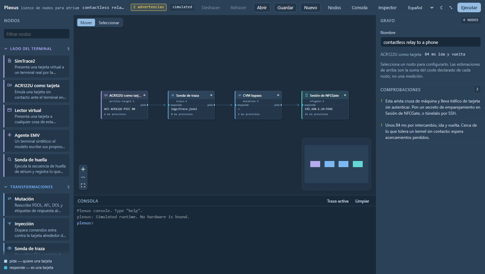

# Languages

The editor speaks English and Spanish. Pick one from the top bar; it is
remembered, and on a first visit it follows the browser's own preference.



Everything the editor writes moves, including the parts generated rather than
written — the checks, the reason a wire was refused, the node titles and the
port labels on the cards:

| | |
|---|---|
| English | *This edge crosses machines and carries card traffic unauthenticated. Set a pairing secret on NFCGate session, or tunnel it over SSH.* |
| Español | *Esta arista cruza de máquina y lleva tráfico de tarjeta sin autenticar. Pon un secreto de emparejamiento en Sesión de NFCGate, o túnelalo por SSH.* |

Note that the node's own name is translated inside the sentence.

---

## What is not translated, and why

**A runtime's own words.** Anything a runtime says — the console's replies, log
lines, bind failures — is the runtime's, not the interface's. From the Python
side it arrives already written, over a socket that carries sentences rather
than message codes; translating half a trace would be worse than leaving it
whole in one language.

The simulator is the case that reason does not cover, because it runs in the
browser and could translate itself. It does not, deliberately: it exists so
that a panel built against it works against a card, and a simulator that
answered `status` in Spanish while the runtime answered in English would stop
being the same thing. A console is a runtime's surface, like a shell's, and the
one it speaks is English in both.

What *is* translated is the console the editor owns around it — the panel
title, the banner, the Clear button. The boundary is who wrote the sentence.

If any of that becomes worth changing, the change is in `PROTOCOL.md`, not in
the dictionaries.

**APDU names and EMV structures.** `PDOL`, `AFL`, `DOL`, `TLV`, `SFI`,
`S(WTX)`, `APDU` stay as they are in every language. Anyone working with them
reads them in English, and a translated tag name would be a tag name nobody can
search for.

**Product names.** SimTrace2, ACR122U, NFCGate, atrium.

**Hex.** Obviously, but worth saying: the trace is bytes.

---

## Terminology, for Spanish

Decisions worth knowing if you are editing `es.ts`, because in this field the
vocabulary matters more than the grammar:

| English | Español | Why |
|---|---|---|
| terminal | terminal | Not *datáfono* or *POS*. The port is called this in the model, and the port's name and the device's name have to match. |
| requester / responder | pide / responde | Translated by what they do, which is how they are explained in English too. |
| contactless | sin contacto | |
| contact card | tarjeta con contactos | The distinction atrium itself draws. |
| capture | captura | |
| playbook | playbook | The name of atrium's format; it appears in the files. |
| workspace | espacio de trabajo | |

---

## Adding a language

Nothing here needs a framework and nothing needs a build step.

**1. Copy the dictionary.**

```bash
cp ui/src/i18n/es.ts ui/src/i18n/fr.ts
```

**2. Register it** in `ui/src/i18n/index.ts`:

```ts
export const LOCALES = ["en", "es", "fr"] as const;

export const LOCALE_NAMES: Record<Locale, string> = {
  en: "English",
  es: "Español",
  fr: "Français",
};

const DICTIONARIES: Record<Locale, Partial<Record<string, string>>> = { en, es, fr };
```

**3. Translate what you can, in any order.** A missing key falls back to
English, then to the key itself. A half-translated build is usable; that is
deliberate, and it means you can ship a language before it is finished.

### Where the strings are

**The chrome** is `ui/src/i18n/en.ts` — that file *is* the key list, about 120
entries. `--font-ui` and the layout are not sized for any particular language,
but German compounds and long Spanish phrases both fit today, so check the top
bar and the palette after a pass.

**Node titles, summaries, caveats and field labels are not in `en.ts`.** They
live in the catalogue, which is also what `plexus/schema/catalogue.json` exports to
the Python side — duplicating them would give the project two canonical
Englishes to keep in step. So only the *other* languages carry node keys, and
the key shapes are derived from the catalogue's own names:

```
node.<nodeKey>.title
node.<nodeKey>.summary
node.<nodeKey>.caveat.<index>
field.<nodeKey>.<fieldKey>.label | .help | .placeholder
option.<nodeKey>.<fieldKey>.<optionValue>
port.<portId>
```

So `node.acr122u.target.title` and `field.nfcgate.cafile.help`. Adding a node
type gives it predictable keys with no second list to maintain.

### Counted phrases

English and Spanish both split one from many, and neither puts the number in
the same place, so each form is a whole phrase rather than a number glued to a
word:

```ts
"count.warnings_one": "1 advertencia",
"count.warnings_other": "{count} advertencias",
```

`tn("count.warnings", n)` picks the form. A language with more than two forms
needs `tn` extended — the three lines that choose a suffix are in
`ui/src/i18n/index.ts`.

### One thing that will bite

`useT()` returns a function whose **identity changes with the locale**, and that
is load-bearing rather than incidental. Several places memoise work that
produces language — the validator's sentences, the palette's filtering — and
list `t` as a dependency. A hook that returned the module-level `t` would
subscribe the component but leave every one of those memos stale, showing the
previous language until something else happened to invalidate them.

If you add a memo over translated output, put `t` in its dependency array.

---

## This manual

The pages here are English, with [Instalación](es/install.md) and
[Tu primer montaje](es/first-run.md) in Spanish — the two a newcomer actually
needs. The rest are not translated yet, and pretending otherwise with a machine
pass would be worse than the honest gap.
