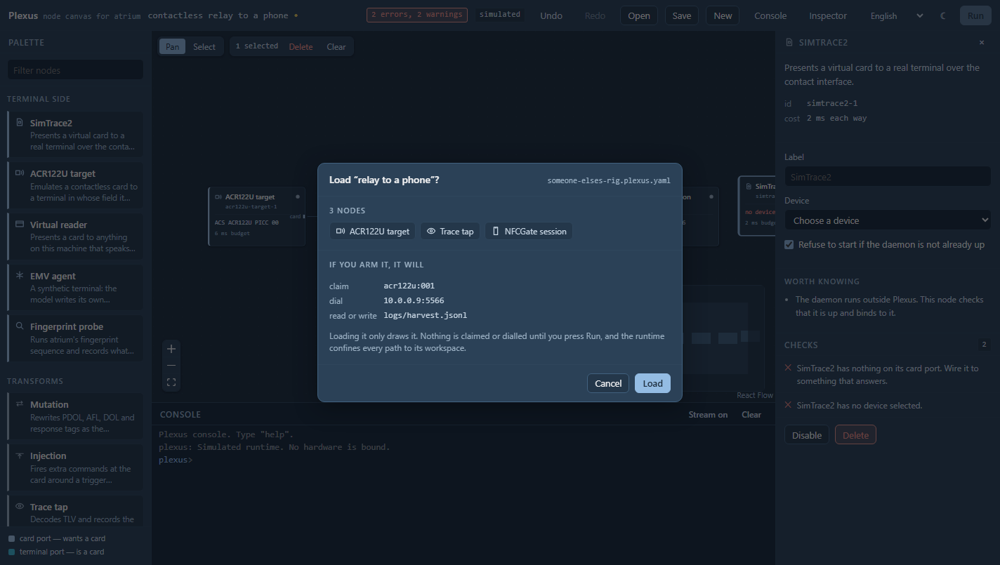

# What it refuses

A `.plexus.yaml` is a document people send each other, and it names hardware to
claim, addresses to dial and files to read and write. So it is treated as
untrusted input.

Everything on this page was **measured open before it was closed**, and each has
a test in `tests/test_security.py`. None of it is a theory about what might go
wrong.

---

## No page you visit can drive the runtime

This is the one that mattered.

A browser does **not** apply the same-origin policy to WebSockets. Any site you
happened to be visiting could open `ws://127.0.0.1:8900/ws`, and the Host header
on that handshake is honestly `127.0.0.1:8900` — so checking Host, which stops
DNS rebinding, lets this straight through. Measured:

```
Origin: https://evil.example.com   →  connection ACCEPTED
```

It could have armed a card relay. *"Loopback is safe because the operating
system decides who can connect"* is not true when the thing connecting is your
own browser, on someone else's instructions.

The Origin header is now checked against an allow-list:

- **loopback origins** — `http://localhost:5173`, `http://127.0.0.1:…` — the
  editor.
- **anything in `PLEXUS_ALLOWED_ORIGINS`**, comma separated.
- **a missing Origin** is allowed, because that is a native client — the CLI, a
  script, a test. A browser always sends one and a page cannot forge it, so
  this check is exactly as strong as the browser's own guarantee.
- **`Origin: null`** is refused. That is a sandboxed iframe or a `file://`
  page, which nothing legitimate does here and a hostile embed does.

## No graph can reach outside its workspace

A trace node's `path` used to be an arbitrary file write — appended JSON,
one line at a time, anywhere the process could reach.

Reads and writes now resolve inside a **workspace**: the directory the runtime
was started in, or `PLEXUS_WORKSPACE`. Anything escaping it is refused by name:

```
Refusing to write /tmp/x.jsonl outside the workspace (/home/you/plexus).
Choose a path inside it, or start the runtime with PLEXUS_WORKSPACE set.
```

Containment is by **resolved path**, not string prefix — a prefix test would
accept `/srv/work-evil` for a root of `/srv/work`. `..` and symlinks are
collapsed before the comparison.

## Nothing runs that a graph brings with it

A mutation node's playbook is YAML that reaches atrium's loader, and that
loader uses `yaml.safe_load` — a tag asking for an object is an error, not a
call:

```yaml
response_mutations: !!python/object/apply:os.system ["echo pwned"]
```

Plexus parses the playbook itself first, before atrium sees it. Not because
`safe_load` is in doubt, but because atrium **logs** a bad document and carries
on with defaults — so the node would bind, the run would start, and you would
believe mutations were armed while nothing was. That is the worst outcome
available, and it now stops the arm.

On the editor side: js-yaml's `load` rejects `!!js/function` and Python tags,
and there is no `innerHTML`, `eval` or `new Function` anywhere in the UI.

## Sizes are bounded

- **Frames** over 1 MB are refused *before being parsed*. The first version
  read the text into an object and then measured it, which is the wrong order.
- **APDUs** larger than a card could read — about 65 kB — are refused before
  they become bytes, in the console and in the injection node alike.

## Opening a graph is not agreeing to it

Open parses the file and shows what it will reach for, before loading anything:



```
claim          acr122u:001
dial           10.0.0.9:5566
read or write  logs/harvest.jsonl
```

Cancel leaves your graph alone. Load replaces it — and still claims nothing
until you press Run.

**This is informed consent, not a boundary.** A dialog in a browser is not a
security control. The boundary is the workspace and the checks, and neither
depends on anyone reading a dialog.

---

## What is deliberately *not* protected

Being explicit, because a security page that only lists wins is not useful.

**There is no authentication on loopback.** Same position atrium takes: the
operating system already decides who can open a local socket, and a password
prompt on a bench tool is theatre. Binding anywhere else refuses to start
without `PLEXUS_API_TOKEN`.

**A token in a URL is a token in your browser history.** `?token=…` is
supported because it is the only thing a WebSocket from a page can carry, and
it is the reason an SSH tunnel is the better answer.

**The runtime trusts whoever reached it.** Once a connection passes the Host,
Origin and token checks, it can arm any graph the workspace allows. There are
no per-user permissions and there is no audit trail beyond the trace files a
graph writes.

**Nothing is encrypted at rest.** Traces are JSONL on disk in the workspace,
and they contain PANs and expiry dates if that is what crossed the wire. That
is what they are for; treat the workspace as the sensitive thing it is.

**Cross-machine card traffic is only as protected as you make it.** The checks
flag an edge that crosses hosts without a pairing secret or a CA file, but they
cannot make it safe — that is `secure_link.py` in atrium, and an SSH tunnel
where it is not.

---

## The environment variables, in one place

| | |
|---|---|
| `PLEXUS_WORKSPACE` | Directory graphs may read and write inside. Default: the runtime's working directory. |
| `PLEXUS_API_TOKEN` | Required to bind a non-loopback address; checked in constant time. |
| `PLEXUS_ALLOWED_HOSTS` | Extra Host header values to accept, comma separated. |
| `PLEXUS_ALLOWED_ORIGINS` | Extra page origins to accept, comma separated. |

## Reporting something

If you find a hole here, it is worth reporting rather than filing publicly.
Every fix on this page came with a test that fails without it — a report that
includes the shape of the attack gets one of those, which is what stops it
coming back.
